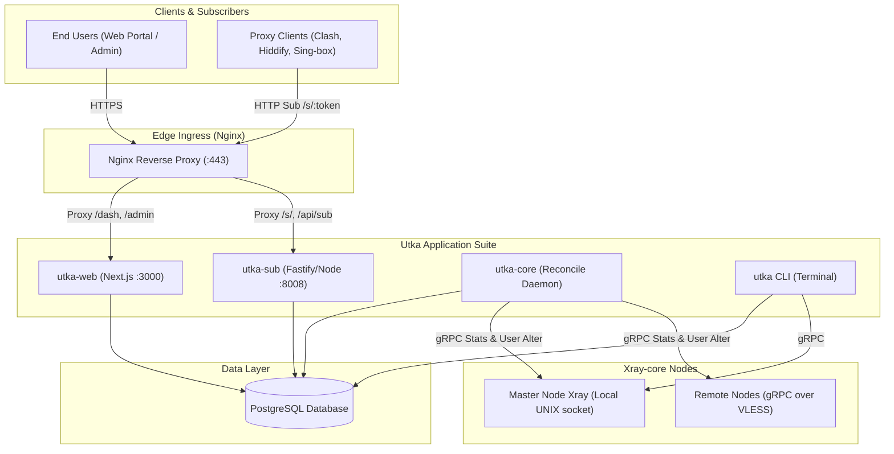

# System Architecture & Topology

This document describes the internal component topology, data flows, and protocol design of Utka.

## Topology Diagram

## Data Flows

1. **User Authentication & Provisioning**:
   - Web visitors authenticate against Authentik via NextAuth OIDC.
   - Upon sign-in, user roles are synchronized from Authentik group claims.
   - Subscriptions and per-inbound UUIDs are generated and persisted in PostgreSQL.
   - `utka-core` pushes the generated UUIDs to all designated Xray inbounds over gRPC `AddUserOperation`.

2. **Subscription Delivery**:
   - Clients request `/s/:token` or `/api/sub/:token`.
   - `utka-sub` retrieves active node configs and subscription metadata from PostgreSQL.
   - Returns client configurations (VLESS / Clash / Sing-box) with live `Subscription-Userinfo` bandwidth usage headers.

3. **Reconciliation & Traffic Sync**:
   - `utka-core` polls Xray's `StatsService` over gRPC periodically (default 15s).
   - Ingests uplink and downlink byte counters, updates database records, and evicts inactive/revoked clients via `RemoveUserOperation`.
